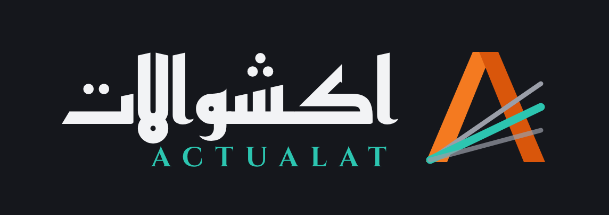

# اكشوالات · Actualat

برنامج ويندوز بيحوّل شيتات المشروع لقوالب استيراد PCS:
- **المستودعات:** صرف المخازن ← PCS Store Issues
- **المستخلصات:** مستخلصات مقاولي الباطن (شيت Sub Contractor في الكوست ريبورت) ← PCS Subcontractor IPC
- **الإقفال الشهري** و **Dashboard** و **السجل**

## التثبيت
نزّل [`Actualat.exe`](Actualat.exe) وشغّله. البرنامج هيعمل الآتي:
1. يثبّت نفسه.
2. يعمل اختصار «اكشوالات» على الديسكتوب وفي قايمة Start.
3. يظهر في تطبيقات ويندوز.

بعد كده بيحدّث نفسه لوحده من [`latest.json`](latest.json).

## محتويات الريبو
| الفولدر / الملف | فيه إيه |
|---|---|
| [`source/`](source) | الكود كامل (Go + WebView2)، وطريقة البناء في README بتاعه |
| [`design/`](design) | الهوية: اللوجو بكل أشكاله، الألوان، الخطوط، صور البرنامج، ولوحات التصميم |
| [`CHANGELOG.md`](CHANGELOG.md) | سجل الإصدارات |
| `Actualat.exe` · `latest.json` | آخر إصدار + ملف التحديث |
