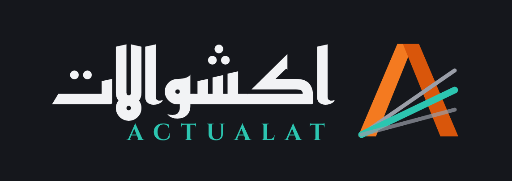
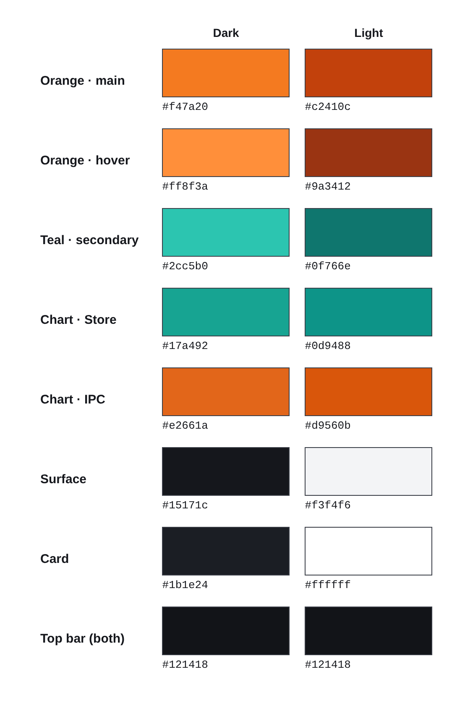

# اكشوالات · Actualat — التصميم والهوية

## الاسم
- عربي: **اكشوالات** — إنجليزي: **ACTUALAT**
- الكلمة العربي بخط **Reem Kufi 700**، وتحتها ACTUALAT بخط **Cinzel 700** بمسافات واسعة وباللون التركواز.

## اللوجو — حرف A بالخطوط
رجلين A مايلين، و3 خطوط طالعة من الركن اللي تحت. الخط اللي في النص تركواز والاتنين التانيين رمادي.

| الملف | الاستخدام |
|---|---|
| `logo/mark-light.svg` · `mark-light-1024.png` | على خلفية فاتحة |
| `logo/mark-dark.svg` · `mark-dark-1024.png` | على خلفية غامقة |
| `logo/icon.svg` · `icon-512.png` | أيقونة البرنامج (48px وأكبر) — مربع غامق #15171c |
| `logo/icon-small.svg` · `icon-small-64.png` | الأيقونة الصغيرة (16–32px): الرجلين + الخط التركواز بس |
| `logo/actualat.ico` | أيقونة ويندوز (16/24/32 من الصغيرة، 48–256 من الكبيرة) |
| `logo/lockup-dark.png` · `lockup-light.png` | اللوجو كامل مع الاسم |

| | رجل A الشمال | رجل A اليمين | الخط التركواز | الخطوط الرمادي |
|---|---|---|---|---|
| على الفاتح | #ea6a12 | #b8400c | #0d9488 | #8b8e95 |
| على الغامق | #f47a20 | #d9560b | #2cc5b0 | #9a9ea8 |

## الألوان

| الاسم في الكود | Dark | Light | بيستخدم في |
|---|---|---|---|
| `--pri` برتقالي | #f47a20 | #c2410c | الأزرار الأساسية، القسم المفتوح، الخط المايل |
| `--pri2` | #ff8f3a | #9a3412 | hover |
| `--on-pri` | #15171c | #ffffff | الكلام اللي على البرتقالي |
| `--sec` تركواز | #2cc5b0 | #0f766e | اللينكات، الـ focus، ACTUALAT |
| `--st` رسومات المخازن | #17a492 | #0d9488 | |
| `--ip` رسومات المستخلصات | #e2661a | #d9560b | |
| الشريط العلوي | #121418 | #121418 | غامق في الوضعين |

- الأحمر والأخضر والأصفر للحالات بس (خطأ / تمام / تنبيه).
- ألوان الرسومات اتفحصت للتباين ولعمى الألوان في الوضعين.

## توقيع الواجهة
- **مفيش شريط جانبي:** شريط علوي غامق فيه اللوجو، والأقسام كلمات من غير أيقونات.
- **الخط المايل:** خط برتقالي 4px مايل `skewX(-24deg)` (نفس ميل رجل الـ A)، تحت القسم المفتوح وتحت عنوان كل صفحة.
- **عناوين الصفحات:** بخط Reem Kufi. الكلام العادي بخط IBM Plex Sans Arabic.
- **شكل Swiss:** خطوط رفيعة 1px، من غير كروت مدوّرة ولا توهج، والأرقام tabular.
- **اللغة:** عربي (RTL) وإنجليزي (LTR).

## الملفات التانية
- `screenshots/` — صور البرنامج (2.1)، ومنها شاشة البداية `welcome_*`، غامق وفاتح وعربي وإنجليزي.
- `canvas/` — لوحات التصميم الأصلية من Claude Design. فيها رحلة اللوجو كلها (B → F واختيار الخط). اتعملت بالأحمر قبل التحويل للبرتقالي والتركواز.
- `fonts/` — Reem Kufi و Cinzel و IBM Plex Sans Arabic (رخصة SIL Open Font License).
